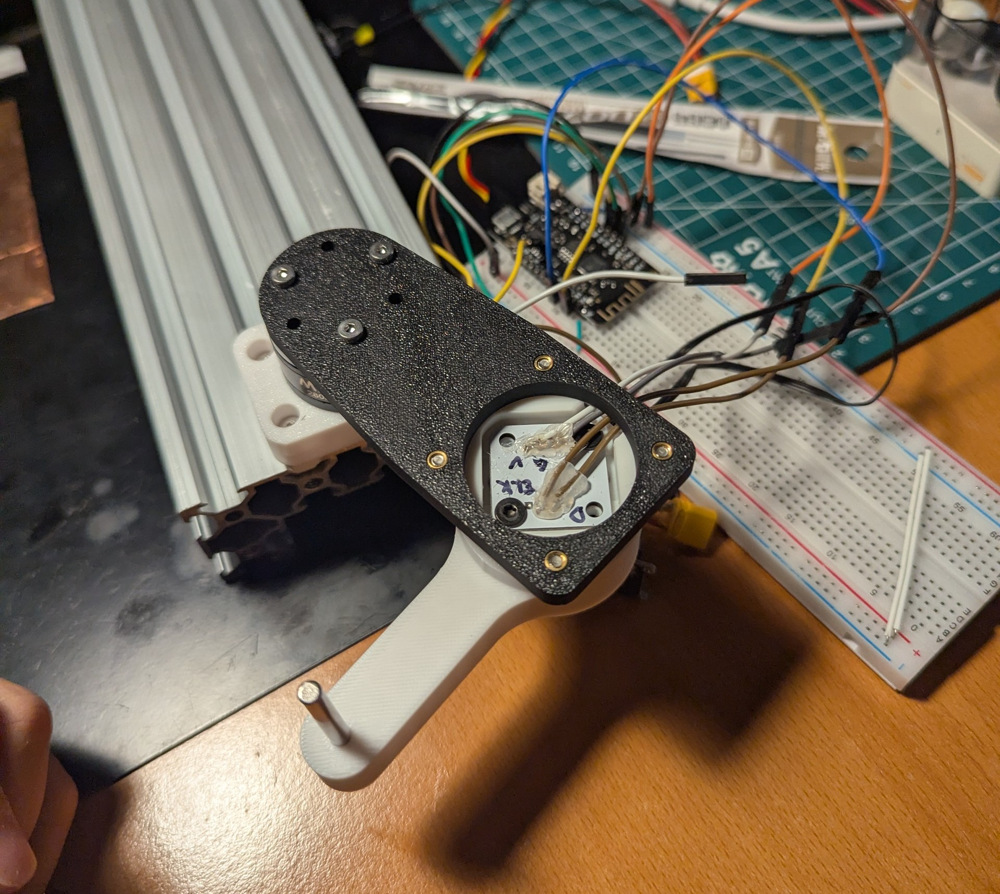

# Overview:

This is a quick project to learn-by-doing FOC control theory and Jacobian-based robotics kinematics. I was inspired by [this video](https://www.youtube.com/watch?v=rFSXDaZQ4Qo) and wanted to make something similar.

The goal is to have a robot arm whose end-effector behaves like a linear slider attached to a spring, with adjustable parameters such as the stiffness/linearity of the virtual spring.

## Hardware
The mechanical design is simple. It's a 2-DOF planar serial link manipulator (aka robot arm) driven by 2804 gimbal motors. The 3-phase driver is a SimpleFOC Mini board, and I put on some cheap encoders (AS5600) for angle sensing. All the connection parts were 3D printed.

## FOC Algorithm & firmware

I learned the theory behind Field-Oriented Control for PMSMs, and hand-wrote the [Park Transform](https://en.wikipedia.org/wiki/Direct-quadrature-zero_transformation) and [Clarke Transform](https://en.wikipedia.org/wiki/Alpha–beta_transformation) code for the ESP32 in the Arduino framework. I did a classic position-velocity-torque nested PID loop and got it to run at roughly 1.8kHz on an ESP32 (using one core for now). Unfortunately the torque control is open loop because the driver board didn't have the current sensing hardware.

I also manually implemented EMA low-pass filters to get rid of the quantization noise from the AS5600 velocity readings (since it's only 12 bits), and then modified the code to run 2 motors from one ESP32. The loop frequency dropped to ~1.4kHz, but still worked well enough for the next part.

## Virtual Spring Behavior
I wanted the end-effector to feel as if it is constrained by a linear rail, and spring-loaded. To achieve this, I can define an arbitrary line that acts as the rail. When the end-effector's position deviates from that line, the controller responds with a large force vector pointing straight to the line. While this isn't a "true" linear rail behavior, it's the best approximation given the limited torque of the gimbal motors. 

The spring behavior is quite simple to approximate: when the end-effector deviates from the neutral position (arbitrarily defined in code), the controller applies a force proportional to the magnitude of deviation. These are done with basic linear algebra.

The overal force vector is the sum of the vector from the virtual linear rail and the spring, which then gets converted to torque.

## Force Vector to Torque
The spring-and-slider behavior outputs a desired end-effector force vector, which needs to be translated to a 2D torque vector to feed into the FOC controller. It's done using conservation of work and the 2DOF forward kinematics Jacobian matrix. 

The ESP32 has hardware FPUs, so this step is not the limiting factor of the loop frequency. Still, it might be better to utilize both cores of the ESP32, one for the FOC, the other for the spring behavior calculation.

worked out the math (relatively simple for 2DOF. more than 2 DOF is a different story...) to translate an arbitrary force vector in $$\mathbb{R}^2$$ into a joint torque vector. I learned the theory behind Field-Oriented Control for PMSMs, and hand-wrote the [Park Transform](https://en.wikipedia.org/wiki/Direct-quadrature-zero_transformation) and [Clarke Transform](https://en.wikipedia.org/wiki/Alpha–beta_transformation) code for the ESP32 in the Arduino framework. I also manually implemented low-p

