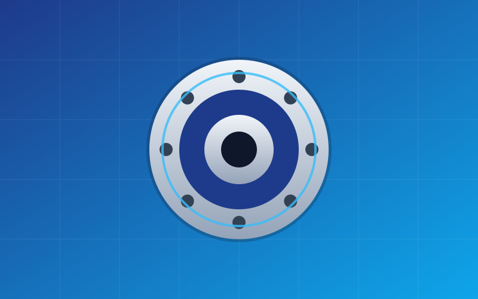

A cantilevered load loves to twist a single bearing out of its housing. Press fits in printed parts tend to loosen over time, so this fixture clamps the outer race with low-profile M2 screws instead.

The clamp ring spreads the load across the race and keeps the bearing square to the shaft. The same idea works for the inner race when space is tight.

- Designed around a 6702 thin-wall bearing
- M2 screw holes on a 24 mm bolt circle
- Printed in PETG at 0.2 mm layers
