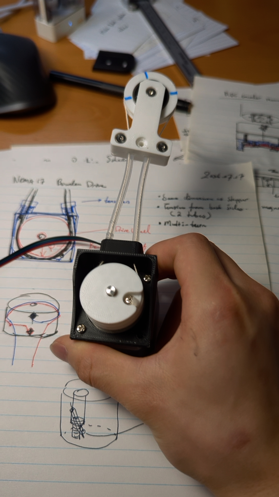

This is a quick prototype of an actuator that uses tubes and cables to move the heavy mass of the actuator away from the joint. Inspired by bicycle brake/shift mechanisms (and the Neo robot hand). [Video demo](https://www.instagram.com/p/DbJzhm7PSTf/)

## Mechanical Design:
This is a proof-of-concept prototype. It uses a stepper motor that drives a spool that pulls a 1mm cotton string (going to switch to dyneema when it arrives) through a 3D printer PTFE tube, and rotates a Capstan pulley as the joint.

Bowden actuators can either have 1 or 2 tubes. 1-tube systems either use push-pull actuation (like a 3D printer bowden extruder) or spring return (like bike brakes). I've gone with a 2-tube design for a few reasons:
- a "proper" robotic actuator should behave the same in both rotation directions. A 2-tube design means that the cable is being pulled by the motor in either directions.
- a push-pull mechanism doesn't work with soft cables.
- a spring return mechanism "wastes" some motor torque, and the return movement is not coupled to the motor's rotation so there's extra nuisance to angle sensing.

## Potential Applications

The main advantage of a bowden actuator is that you can use a powerful (often heavy) actuator to drive a joint where low inertia is needed (such as an end-effector gripper). The only limit to the torque output is the tensile strength of the cable, and how much radial stress the tubing can handle. In a future version I will try using bike brake tubes for more strength, although flexibility would be lower.
