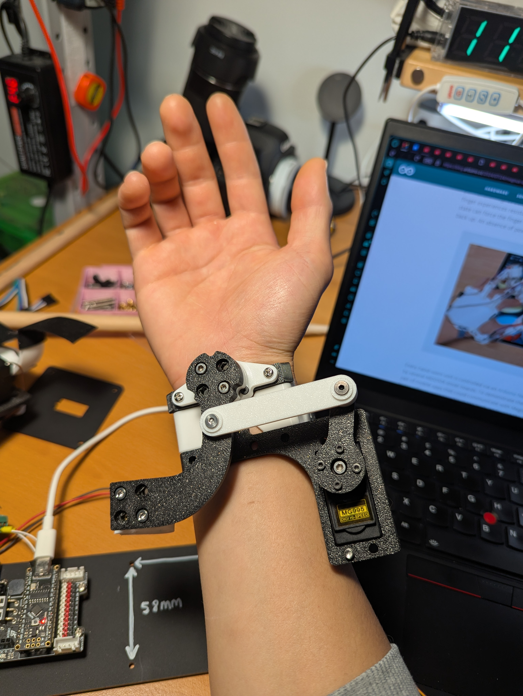
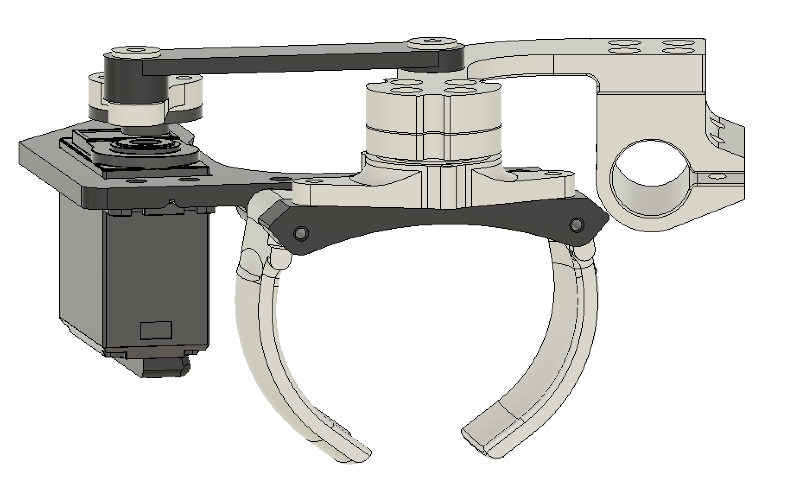
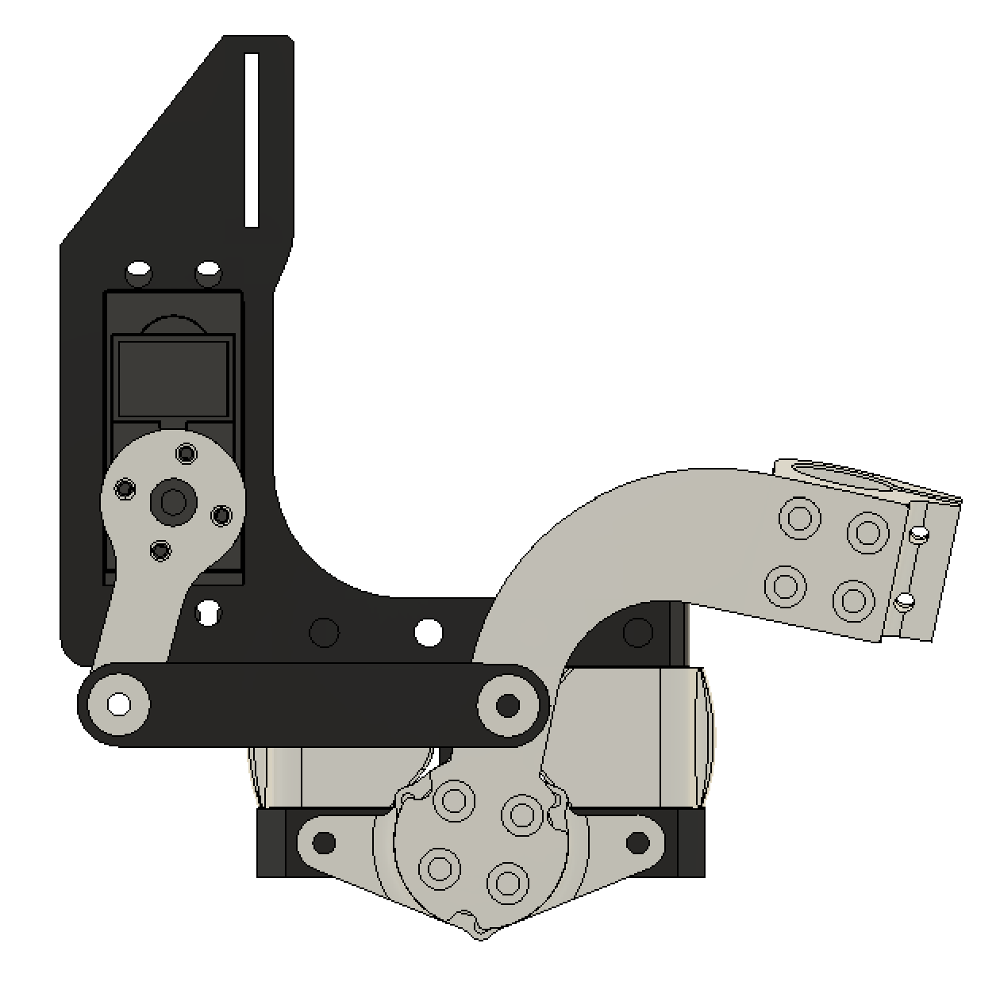
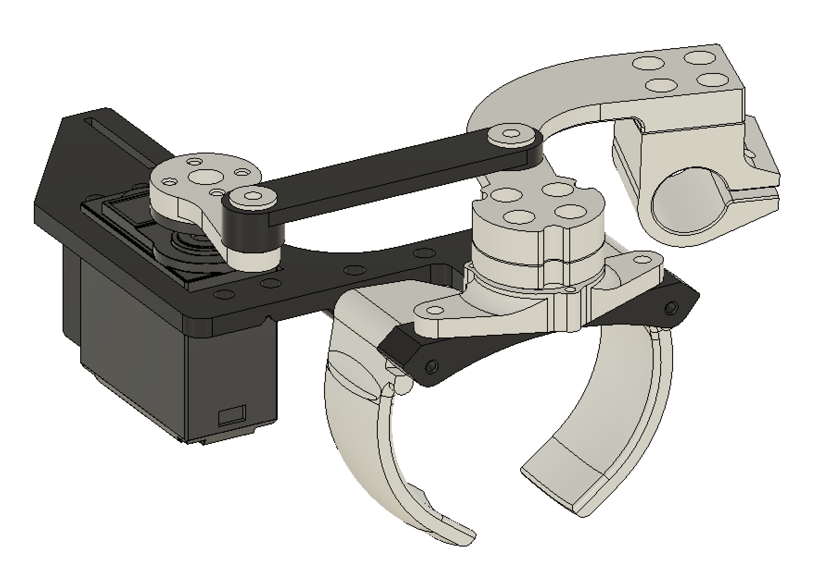

# Overview
This is a powered-exoskeleton for the wrists that teaches you to play drums, and create muscle memory so that even after taking off the exoskeleton, you can still play the pattern. It uses a python script to parse the drum tracks from a MIDI file, and sends the relevant timing & track information to an MCU, which controls the wrist joint motors of the exoskeleton and moves the user's hands in the right timing.

<!-- <video controls playsinline preload="metadata" width="100%">
  <source src="/assets/img/projects/drum_robot/PXL_20260629_190617747.TS.mp4" type="video/mp4">
</video> -->

## How it started
I played the drums in a band with my friends, but I've never played before. I watched a bunch of YouTube videos on drums, and stumbled upon a Jacob Collier polyrhythm video. I tried to tap out a 2-3 polyrhythm, which was manageable; then I tried a 3-4 polyrhythm, and failed miserably. 

I thought about how young children can learn things (like using a spoon) when their parents hold their hands to teach them. Maybe it's also possible to learn drums if someone (or some robot) is holding my hands? That's how I decide to build this robot.

# Hardware Design
The V1 design is quite simple, as it's meant to be a proof-of-concept to see whether a robot can actually teach me the muscle memory of drum patterns and two-hand coordination. Spoiler: it can!

The system consists of two independent exoskeletons for the left and right hand, each driven by a MG996 servomotor. A quick-detach clamp mechanism fixes the exoskeleton to the wrist. The clamps are printed from TPU to conform to the shape of the wrist. A low profile thin-wall bearing is placed at the virtual rotation axis of the wrist (Ulnar deviation), and a drumstick is attached to the rotating piece for the user to hold onto. The servo moves the drumstick via a 4-bar linkage, which in turn moves the hand.

The two servos are controlled by a RP2040 microcontroller, and the whole system is powered by a 2s LiPo battery. The MCU can store pre-programmed drum patterns, or it can be connected to a computer running a python script that parses the drum tracks from a MIDI file. 

# Firmware & Software
I want to eventually be able to load any drum pattern from a song onto the robot, and interfacing with MIDI is a promising way. In this version, I export a drum pattern from Reaper (or any DAW) and a python program parses out the drum beats using the Mido library. Then, the left/right hand drum beats are streamed to the microcontroller, which then moves the servos. The python program runs on a computer like a Raspberry Pi, which seems a bit overkill. In the next version I will try implementing the MIDI parsing on the RP2040 itself.
