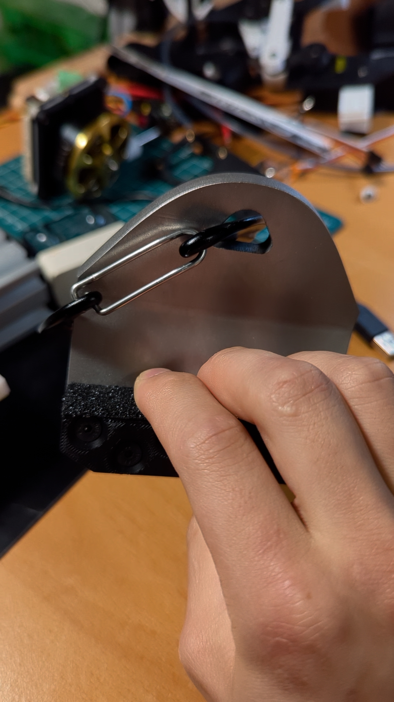

As an engineering student, it is almost obligatory for me to get into rock climbing. After falling off the same V6 overhang for around the 10th time, I realized that my finger strengh needs improving. I searched online for a hangboard for weighted finger training, and found that even the basic ones could easily go for more than $50.... That's when I decided to make it myself.

## Structural Design
### Sheet metal body
This design uses a 6mm thick 304 stainless steel plate as the main structure (waterjet cut and bent, provided by PCBWAY), which is extremely overkill for this project. There are 7 threaded M4 holes that require tapping. The carabiner hole at the top fits the most common climbing carabiners, like the Black Diamond mini wiregate.

### Modular grip piece
The finger piece is a separate 3D printed part, which allows me to make various different grip profiles (crimp shape, depth, width, etc.) with low cost. The grip piece is optimized for FDM printing: the load-bearing direction doesn't sheer the layers apart. The grip piece is attached to the sheet metal using 7x M4 bolts. The bolts' clamping force compresses the printed layers together to further strengthen it. 

## Cost:
This hangboard is meant to be a low-cost and highly customizable DIY solution to typical wooden/casted hangboards. The sheet metal part has a bend radius of 12mm, which is manufactuable by pretty much all sheet metal manufacturers. If you order it from China and print the grip piece yourself, the overall cost is less than $10.

# [Video Demo](https://www.instagram.com/leons_random_makes/reel/Dc7W6OhqRm4/)