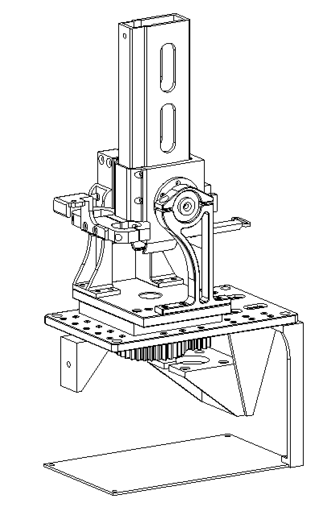

This is a nerf turret that tracks faces, I trained it to recognize my sister. I built it in 2023 so can't find pictures :(

The dart launcher was designed from scratch, it shoots half-length darts with flywheels, fed by a Talon magazine. The pan axis is driven by a stepper, the tilt is controlled by a MG995 servo. An OpenMV camera runs Harr-Cascade facial detection, and communicates with an Arduino nano over UART to move the turret. 