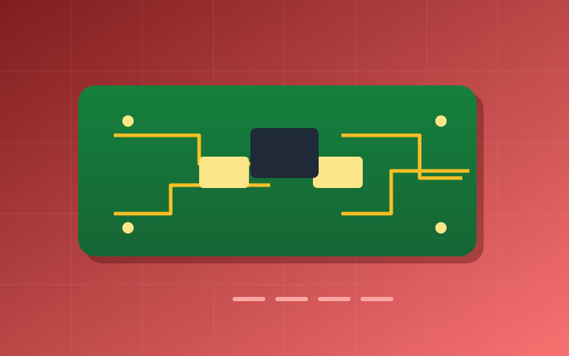

Hand soldering 0402 parts is a patience test. This hotplate uses a machined aluminium block, a cartridge heater, and a thermocouple tucked into a drilled well for closed-loop temperature control.

An ESP32 runs a reflow profile on a small OLED and logs each run over serial so I can compare curves between boards.

- 300 W cartridge heater
- K-type thermocouple feedback
- Adjustable reflow profile with soak and peak stages
