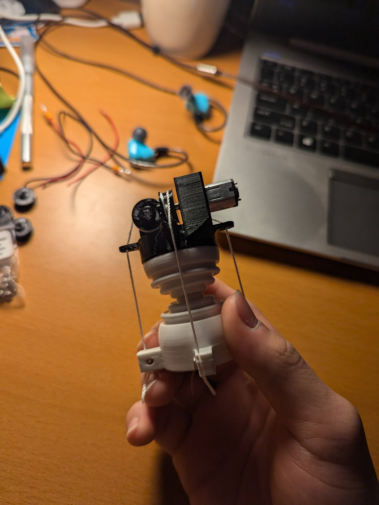
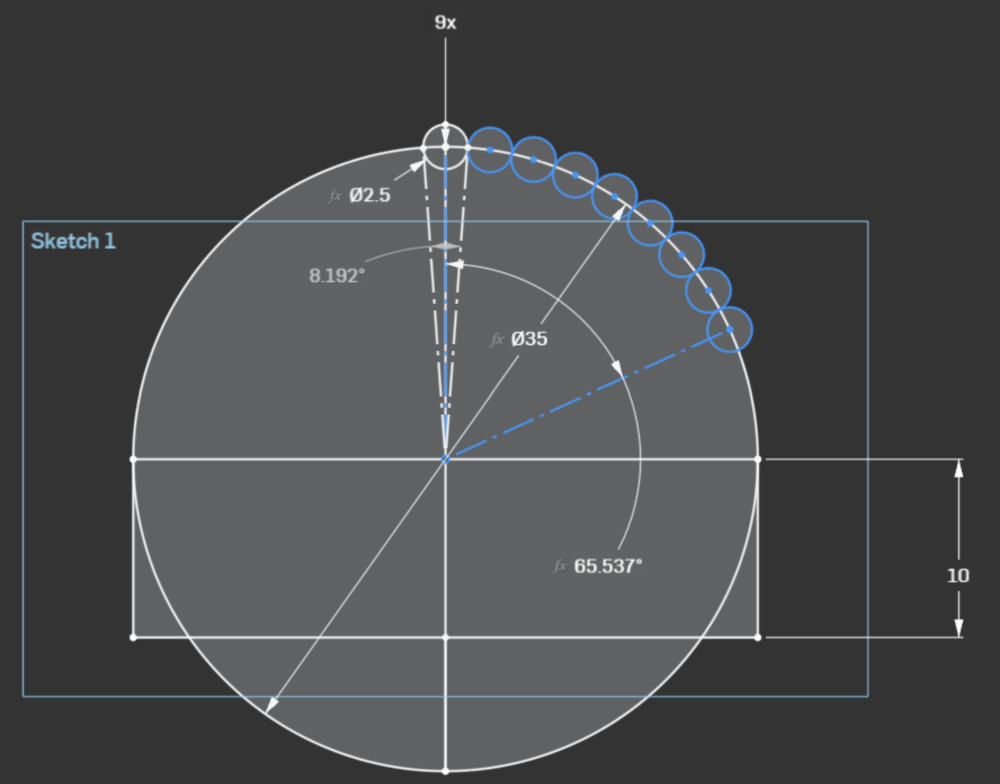
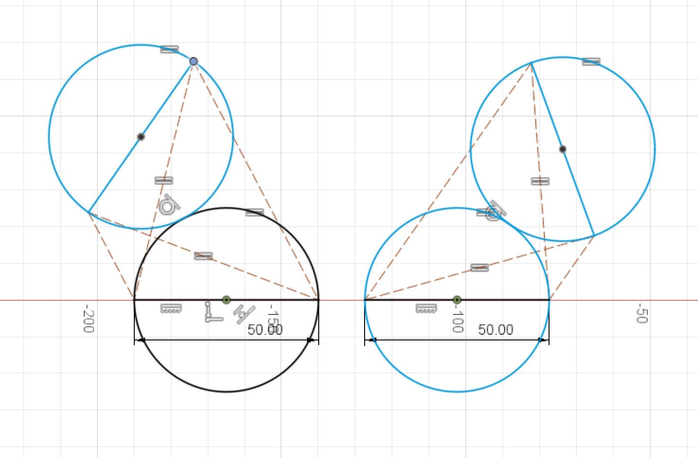

# Summary

This is a prototype of a 2 degree of freedom cable driven actuator with a spherical rolling contact surface. 

I was inspired by the planar rolling contact joint on the elbow of the [LIMS3 Ambidex](https://www.cs.cmu.edu/~cga/c/0749.pdf) and thought: what if I can extend the rolling contact idea to 3 dimensions and get a 2-DOF joint? (Kind of similar to the human [knee joint](https://www.physio-pedia.com/Knee))

## Mechanical Design

The construction is simple: two half spheres with meshing "gears" (I was lazy with this prototype and used circular groove profiles instead of involute gear profile) and two N20 gearmotors that drive the cable. 

"Gear" tooth profile: 

Motors & cable routing:

Ideally, a rolling contact joint can be driven with one motor and a pulley that is attached to both strings (for each DOF). This requires that the length of string feeding into the joint is equal to the length going out of the joint, which happens to be the case for a circular rolling element.

The result is promising. The stiffness of the joint is surprisingly high for something that's held together by the tension of two strings, and the actuation is quite accurate around the center. Toward the edges of the motor travel, the string tension decreases a bit. It is probably because the string attachment points are not on the surface of the virtual sphere...

## [Video demo](https://www.instagram.com/p/DCcVt5QyM-M/)
